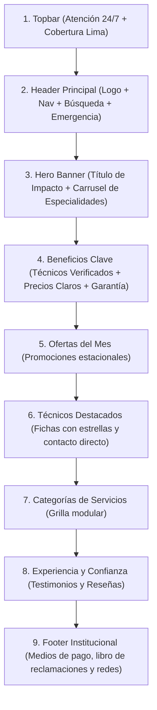

# Sistema de Diseño: Chapa Tu Técnico 🎨📐

**Diseño Oficial en Figma:** [CHAPA-TU-TECNICO (Figma)](https://www.figma.com/design/qg00MT4SVQUrHSM8c58jFt/CHAPA-TU-TECNICO?m=auto&t=UcRT9b8HSTMI72Ax-1)

---

## 1. Filosofía de Diseño: Figma como Base Flexible

> [!NOTE]
> **Principio Rector:** El archivo de Figma constituye la base conceptual, visual y estructural del proyecto. Sin embargo, la experiencia interactiva real en el navegador (tiempos de carga, ergonomía táctil en móviles, contraste de accesibilidad y transiciones a 60fps) manda.
> Si durante la maquetación y programación una solución en código resulta más clara, rápida o visualmente más pulida que el diseño inicial, **se adopta dicha mejora en código y se traslada posteriormente al Figma**, asegurando una evolución dinámica y no restrictiva.

---

## 2. Anatomía y Secciones de Home / Inicio (`index.html`)

La página principal está modularizada en secciones independientes pero unificadas bajo un mismo lenguaje visual:



### Detalle por Sección:
1. **Topbar Compartido:** Franja superior que comunica cobertura exclusiva en Lima Metropolitana, atención 24/7 y selector de idioma.
2. **Header Principal:**
   - Logotipo de alta nitidez en formato SVG/WebP.
   - Navegación clara (`Inicio`, `Nosotros`, `Servicios`, `Cobertura`, `Soporte`).
   - Botón CTA de alta visibilidad: **EMERGENCIA 24/7** con enlace directo a WhatsApp.
   - Barra de búsqueda central con soporte para búsqueda textual y botón de voz.
   - Iconos de acción del usuario: Mi Cuenta, Notificaciones y Carrito.
3. **Hero Banner & Carrusel:**
   - Titular de alto contraste con acentos en amarillo y verde de seguridad.
   - Cruces ornamentales y carrusel deslizable con imágenes optimizadas (WebP) de electricistas, gasfiteros, cerrajeros y carpinteros.
4. **Beneficios (Trust Badges):**
   - 3 pilares de confianza: *Técnicos Identificados*, *Precios Transparentes* y *Garantía Asegurada*.
5. **Ofertas del Mes:**
   - Carrusel de promociones destacadas con badges de descuento.
6. **Footer Compartido:**
   - Enlaces agrupados, canales de soporte (WhatsApp y teléfono), pasarelas aceptadas (Yape, Plin, Visa, Mastercard) y acceso al Libro de Reclamaciones según normativa peruana.

---

## 3. Tokens de Diseño Globales (`:root`)

Los tokens están centralizados en `styles.css` para mantener coherencia en todas las vistas:

```css
:root {
  /* Paleta Corporativa */
  --bg: #08233b;           /* Azul profundo principal */
  --bg-dark: #061b2e;      /* Fondo de header/footer */
  --white: #ffffff;        /* Texto principal y tarjetas claras */
  --muted: #c9d4de;        /* Texto secundario y subtítulos */
  --orange: #e8532b;       /* Acento de atención y alertas */
  --red: #e5482e;          /* Emergencia / Destacados */
  --green: #5fd068;        /* Validación, éxito y WhatsApp */
  --yellow: #fdb913;       /* Calificaciones y acento de marca */
  --line: rgba(255, 255, 255, 0.22); /* Bordes sutiles */

  /* Tipografía Modular */
  --font-title: 'Oswald', sans-serif;  /* Titulares, badges y números */
  --font-body: 'Raleway', sans-serif;  /* Textos de lectura y formularios */

  /* Escala de Espaciado Canónica de 8pt */
  --space-1: 4px;   /* Micro-espaciado */
  --space-2: 8px;   /* Espaciado compacto */
  --space-3: 16px;  /* Espaciado base (padding de cards) */
  --space-4: 24px;  /* Separación de grupos */
  --space-5: 32px;  /* Padding mayor */
  --space-6: 48px;  /* Separación de secciones */

  /* Ergonomía Táctil y Accesibilidad */
  --min-touch-target: 44px; /* Tamaño mínimo interactivo móvil */
}
```

---

## 4. Reglas de Rendimiento y Prevención de CLS

1. **Aspect Ratio Obligatorio:** Toda imagen en tarjeta o banner debe declarar su relación de aspecto (`aspect-ratio: 16/9`, `aspect-square`, etc.) para evitar saltos de página durante la carga.
2. **Formato WebP/SVG:** Priorizar recursos vectoriales limpios y WebP con compresión moderna.
3. **Animaciones a 60fps:** Limitar transiciones CSS a `transform` y `opacity` con curvas de desaceleración `ease-out`.

